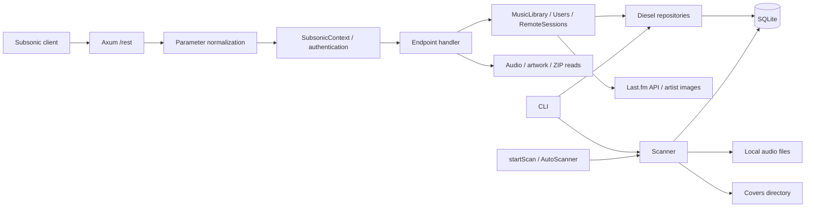

# Inventory: suboxide

Survey date: 2026-11-01. Source revision:
`2c954d360f53b345563b69aa6f0d752c375afe83`.

This is descriptive evidence about the existing project for agents preparing
later changes. It records observed behavior, source pointers, and verification
limits; it does not turn every existing capability into a requirement or imply
full Navidrome feature parity. Future personal changes remain unspecified.

## 1. Project boundary and status

- suboxide is a self-hosted HTTP music server. Local audio is indexed in SQLite
  and exposed to external Subsonic clients. The repository contains a server,
  administrative CLI, and NixOS module; no built-in web UI was found in the
  registered routes or source.
- One Cargo package, version `0.1.0`, Rust edition `2024`, provides a library and
  binary under the MIT license. [AGENTS.md](../../AGENTS.md) identifies it as
  pre-release alpha and allows breaking changes unless compatibility is requested.
- The README describes partial Subsonic/OpenSubsonic support and personal use.
  The route list below is source-confirmed; complete protocol compatibility and
  the README's named client applications were not tested during this survey.
- SpecD was adopted after the existing implementation. This inventory is supporting documentation outside the SpecD artifact DAG.

Sources: [Cargo.toml](../../Cargo.toml), [Cargo.lock](../../Cargo.lock),
[README.md](../../README.md), [LICENSE](../../LICENSE), [specd.yaml](../../specd.yaml),
[SpecD schema](../../schemas/sdd/schema.yaml).

## 2. Component map

| Area | Responsibility and entry points |
| --- | --- |
| Startup and CLI | [src/main.rs](../../src/main.rs): `Cli`, `Commands`, `setup_database`, `run_server`, administrative command runners |
| Application assembly | [src/app.rs](../../src/app.rs): `AppState`, `create_router`, REST route groups, parameter normalization, middleware |
| HTTP conventions | [router.rs](../../src/api/router.rs), [auth.rs](../../src/api/auth.rs), [response.rs](../../src/api/response.rs), [error.rs](../../src/api/error.rs): GET/POST and `.view`, authentication extractors, XML/JSON, Subsonic errors |
| Endpoint handlers | [src/api/handlers/](../../src/api/handlers): browsing, annotation, playlists, playqueue, bookmarks, radio, media, remote, scanning, system, users |
| Services | [src/api/services.rs](../../src/api/services.rs): `MusicLibrary`, `Users`, `RemoteSessions`; repository, personal-data, and Last.fm coordination |
| Data access | [connection.rs](../../src/db/connection.rs), [schema.rs](../../src/db/schema.rs), [repo/](../../src/db/repo): SQLite pool, runtime schema/index setup, synchronous Diesel queries |
| Models and representations | [music.rs](../../src/models/music.rs), [user.rs](../../src/models/user.rs): domain entities, API IDs, search normalization, response structures |
| Collection scanning | [engine.rs](../../src/scanner/engine.rs), [state.rs](../../src/scanner/state.rs), [types.rs](../../src/scanner/types.rs): `Scanner`, `AutoScanner`, progress, overlapping-scan guard |
| Local media resources | [lyrics.rs](../../src/lyrics.rs), [cover_art.rs](../../src/cover_art.rs), [paths.rs](../../src/paths.rs): embedded lyrics/LRC, artwork names/hashes, runtime paths |
| Passwords | [src/crypto/password.rs](../../src/crypto/password.rs): Argon2 hashing/verification and typed errors |
| External integration | [client.rs](../../src/lastfm/client.rs), [models.rs](../../src/lastfm/models.rs): Last.fm signatures, authorization, scrobbling, artist metadata |
| Delivery | [flake.nix](../../flake.nix), [package.nix](../../nix/package.nix), [module.nix](../../nix/module.nix), [workflows/](../../.github/workflows): devshell, package, systemd service, CI/release |

[src/lib.rs](../../src/lib.rs) exports the main areas. `AppState::new`, `FromRef`,
and `create_router` in `app.rs` wire state and services together.

The manifest uses Axum 0.8, Tokio, Tower/Tower HTTP, Serde JSON, quick-xml,
Diesel/r2d2 with bundled SQLite, Argon2, MD5, reqwest with rustls, scraper, lofty,
WalkDir, Rayon, clap, image, zip, and the mimalloc global allocator. Cargo.lock
records resolved dependency versions; manifest ranges are not exact lock versions.

This diagram shows main flows, not a complete call graph: scanning handlers also
obtain the pool directly from `SubsonicContext`. Synchronous service methods call
Diesel repositories directly, without a shared asynchronous database adapter.
Background scanning, ZIP generation, and image resizing use blocking tasks.

## 3. External surface

### 3.1. HTTP and formats

[src/app.rs](../../src/app.rs) registers **72 named operations**.
`SubsonicRouterExt::subsonic_route` adds GET and POST for each name and its
`.view` variant under `/rest`.

| Route group | Operations |
| --- | --- |
| System, 4 | `ping`, `getLicense`, `getOpenSubsonicExtensions`, `tokenInfo` |
| Browsing, 25 | `getMusicFolders`, `getIndexes`, `getArtists`, `getArtist`, `getAlbum`, `getSong`, `getAlbumList2`, `getGenres`, `search3`, `getRandomSongs`, `getSongsByGenre`, `getArtistInfo2`, `getAlbumInfo2`, `getSimilarSongs2`, `getTopSongs`, `getMusicDirectory`, `getAlbumList`, `getStarred`, `getArtistInfo`, `getAlbumInfo`, `getSimilarSongs`, `search2`, `search`, `getLyrics`, `getLyricsBySongId` |
| Annotation, 7 | `star`, `unstar`, `getStarred2`, `scrobble`, `reportPlayback`, `getNowPlaying`, `setRating` |
| Bookmarks, 3 | `getBookmarks`, `createBookmark`, `deleteBookmark` |
| Playlists, 5 | `getPlaylists`, `getPlaylist`, `createPlaylist`, `updatePlaylist`, `deletePlaylist` |
| Play queue, 4 | `getPlayQueue`, `savePlayQueue`, `getPlayQueueByIndex`, `savePlayQueueByIndex` |
| Remote control, 8 | `createRemoteSession`, `joinRemoteSession`, `getRemoteSession`, `closeRemoteSession`, `sendRemoteCommand`, `getRemoteCommands`, `updateRemoteState`, `getRemoteState` |
| Media, 4 | `stream`, `download`, `getCoverArt`, `getAvatar` |
| Radio, 4 | `getInternetRadioStations`, `createInternetRadioStation`, `updateInternetRadioStation`, `deleteInternetRadioStation` |
| Users, 6 | `getUser`, `getUsers`, `deleteUser`, `changePassword`, `createUser`, `updateUser` |
| Scanning, 2 | `startScan`, `getScanStatus` |

- POST `application/x-www-form-urlencoded` bodies are merged with query
  parameters, with form values first and repeated parameters retained. The form
  read limit is 10 MiB. Other POST requests use query parameters.
- Responses default to XML; `f=json` selects JSON. The API version constant is
  `1.16.1`. JSONP is rejected despite its mention in the opening response-module
  comment.
- Protocol errors use a `subsonic-response` envelope, usually HTTP 200.
  Middleware and binary/range responses use their own statuses, including 408,
  413, 206, and 416.
- Advertised extensions are `apiKeyAuthentication`, `formPost`, `indexBasedQueue`,
  `playbackReport`, and `remoteControl` version 1; `songLyrics` versions 1 and 2.
- API ID prefixes are `mf-`, `al-`, `ar-`, and `pl-` for songs, albums, artists,
  and playlists. `EntityId::parse` treats a bare integer as a song ID; specialized
  album/artist/playlist parsers also accept bare integers in their own context.

Sources: [router.rs](../../src/api/router.rs),
[app.rs](../../src/app.rs) (`normalize_request_params`),
[response.rs](../../src/api/response.rs) (`Format`, `supported_extensions`),
[error.rs](../../src/api/error.rs), [music.rs](../../src/models/music.rs) (`EntityId`).

### 3.2. CLI

| Command | Actions |
| --- | --- |
| `user` | `create`, `list`, `update`, `delete`; the first administrator is created explicitly |
| `api-key` | `generate`, `revoke`, `show` for a user |
| `folder` | `add`, `list`, `remove` for local music folders |
| `lastfm` | `configure`, `set`, `unlink`, `link`, `debug` |
| `scan` | All folders or `--folder`; `--full` selects a full pass |
| `serve` | Server with `--auto-scan` and `--auto-scan-interval` |

Global options are `--database` (default `suboxide.db`) and `--port` (4040).
Without a subcommand, the binary starts the server with auto-scan disabled.
Database setup precedes every command's dispatch. With no users, the server
prints administrator-creation guidance and does not create an account itself.
Source: [src/main.rs](../../src/main.rs) (`Cli`, `Commands`, `main`, `run_server`).

## 4. Authentication and personal-data access

- All registered system handlers, including `ping`, use authenticated
  `SubsonicContext`. Common parameters are `v` and `c`; the client version is
  parsed and checked against the supported maximum `1.16.1`.
- Authentication accepts `apiKey`, `u` + `p` (plain or `enc:` hex password), or
  `u` + `t` + `s` using MD5(password + salt). Mixing API-key and user credentials
  is rejected. Username/token/salt can fall back to `X-Subsonic-*` headers.
- Parsing errors have distinct paths. `SubsonicQuery<T>` returns a protocol
  `ApiError::Generic` for typed-parameter deserialization failure. In
  `SubsonicAuth::from_request`, failed `AuthParams` deserialization instead falls
  back to default parameters, then header fallback and the ordinary format,
  version/client, and credential checks run. It is not a universal parse-error
  response across both extractors.
- `users.password_hash` stores an Argon2 hash; `users.subsonic_password` stores
  the original password for token authentication. API keys and Last.fm session
  keys have separate database fields. No runtime credential values were read.
- Password-update paths differ. CLI `run_user_command` hashes an updated
  password and calls `UserRepository::update_password`, which changes only
  `password_hash`. API `Users::change_password` calls that method and then
  `update_subsonic_password`, changing both fields. Consequently a CLI password
  update leaves the prior token-auth password field in place. This source
  observation is not a request to change behavior.
- Roles are stored as flags. Checks include `stream_role`, `download_role`,
  `cover_art_role`, and `playlist_role`; administrator checks cover `startScan`,
  administrative user operations, and radio changes. Jukebox/upload/podcast/
  sharing/video-conversion flags alone do not establish implemented operations.
- Stars, ratings, bookmarks, scrobbles, and saved queues use user IDs. Playlist
  listing selects owned or public playlists, and `getPlaylist` rejects another
  owner's private playlist; updates/deletion check ownership. Playlist downloads
  take a different path: `media.rs::download` checks `download_role` and calls
  `get_playlist`/`get_playlist_songs` without the retrieval handler's owner/public
  gate. Those repository reads filter by playlist ID, with no caller-user filter.
- Remote pairing joins devices of the same user. The music catalog is shared
  with personal records; no per-user permitted-folder model was found in the schema.

Sources: [auth.rs](../../src/api/auth.rs) (`NormalizedParams`, `SubsonicQuery`,
`SubsonicAuth::from_request`), [user model](../../src/models/user.rs)
(`User::verify_token`, `UserRoles`), [password.rs](../../src/crypto/password.rs),
[main.rs](../../src/main.rs) (`run_user_command`),
[services.rs](../../src/api/services.rs) (`Users::change_password`, playlist reads),
[user repository](../../src/db/repo/user.rs) (`update_password`,
`update_subsonic_password`), [user handlers](../../src/api/handlers/users.rs),
[playlist handlers](../../src/api/handlers/playlists.rs),
[media handlers](../../src/api/handlers/media.rs),
[playlist repository](../../src/db/repo/playlist.rs),
[remote repository](../../src/db/repo/remote.rs) (`join_session`).

## 5. Storage and data model

File-backed SQLite uses synchronous Diesel and r2d2. `DbConfig` defaults to a
10-connection pool and 30-second connection timeout. Connections enable foreign
keys, a 5-second busy timeout, NORMAL synchronous mode, a 64,000 KiB cache, and
256 MiB mmap. `run_migrations` enables WAL and creates/extends the schema.

| Data | Tables in `src/db/schema.rs` |
| --- | --- |
| Accounts and credentials | `users` |
| Shared catalog | `music_folders`, `artists`, `albums`, `songs` |
| Personal activity | `starred`, `user_ratings`, `now_playing`, `scrobbles`, `bookmarks` |
| Playlists | `playlists`, `playlist_songs`, including song order |
| Saved queue | `play_queue`, `play_queue_songs` |
| Last.fm cache | `artist_lastfm_info` |
| Shared settings | `settings`: key/value entries including Last.fm credentials and last-scan time |
| Radio | `internet_radio_stations` |
| Remote control | `remote_sessions`, `remote_commands`, `remote_state` |

The Diesel schema contains 20 tables. Song records include path/folder, artist/
album relationships, file size/mtime, tags, audio properties, artwork, and play
count. Lyrics are read from files on request rather than stored in a table.
Audio remains in music folders; extracted artwork is stored separately on disk.

`setup_database` invokes `connection.rs::run_migrations`: runtime `CREATE
TABLE/INDEX`, `ensure_column`, and search-name backfills. The four SQL migration
directories define 17 of the 20 current tables with earlier field sets; they do
not describe the entire current database.

Search uses normalized `search_name` fields and SQL LIKE. Normalization uses
NFKD, removes combining marks, lowercases, normalizes whitespace and some Latin
characters. Query normalization also removes surrounding quotes and a trailing
`*`. Tests cover accents/case and music-folder filtering.

Sources: [connection.rs](../../src/db/connection.rs),
[schema.rs](../../src/db/schema.rs), [migrations/](../../migrations),
[repositories](../../src/db/repo), [music.rs](../../src/models/music.rs)
(`normalize_search_text`, `normalize_search_query`).

## 6. Main flows

### 6.1. Collection import and scanning

1. An operator registers local folders with CLI `folder add`.
2. CLI `scan`, API `startScan`, or `AutoScanner` invokes `Scanner`. Enabled
   folders are processed sequentially; the CLI can select one folder.
3. WalkDir discovers files; lofty reads metadata in parallel using Rayon.
   Recognized extensions are `mp3`, `flac`, `ogg`, `opus`, `m4a`, `aac`, `wav`,
   `wma`, `aiff`, `ape`, and `wv`. This is an extension list, not evidence of
   decoding a sample collection in every format.
4. Incremental scanning skips a known path only when its second-resolution mtime
   and file size match; full scanning processes all discovered files again.
5. Artist/album/song records are created or updated. Artwork comes from known
   local filenames and embedded pictures; scanner artwork IDs use content MD5.
6. Songs whose paths are absent from disk are removed; album statistics are
   refreshed and orphan albums/artists removed. A successful all-folder pass
   saves `SETTING_LAST_SCAN_AT` for API `lastModified`.

API and auto-scan share `ScanStateHandle`; RAII `ScanGuard` prevents overlapping
scans within that process. `startScan` returns current status when a scan is
already running. CLI scanning is a separate process with separate state; no
shared cross-process scan lock was found. Progress includes count, total, phase,
and current folder. Auto-scan defaults to disabled; when enabled it waits the
interval before an incremental pass, with a default interval of 300 seconds.

WalkDir errors are logged and skipped. Their interaction with missing-path
cleanup matters when a subtree is temporarily inaccessible; that situation was
not exercised in this survey.

Sources: [engine.rs](../../src/scanner/engine.rs) (`scan_all_with_options`,
`scan_folder_with_options`, `discover_files_with_paths`,
`split_discovered_files_for_mode`, `AutoScanner::run_scan_loop`),
[state.rs](../../src/scanner/state.rs), [types.rs](../../src/scanner/types.rs),
[scanning handlers](../../src/api/handlers/scanning.rs).

### 6.2. Browsing, playback, and personal listening

- Browsing combines directory-style and ID3-style operations, search, lists,
  random/genre selections, stars, and annotations. `getSimilarSongs*` and
  `getTopSongs` use local service selections; their names do not establish use
  of Last.fm recommendation APIs.
- `stream` serves original bytes through Tokio/ReaderStream. It supports single
  byte ranges starting at an offset (`bytes=N-M`, `bytes=N-`); its parser does
  not support suffix or multipart ranges. There is no transcoding: `maxBitRate`,
  `format`, and several video parameters are accepted but ignored.
- Song-file access checks that the canonical path is inside an enabled music
  folder. This handler check is not an audit of all application file access.
- `download` returns a song or streaming ZIP for an album, artist, or playlist.
  Multi-disc albums use disc directories; playlist archives include an M3U.
  Operation-specific playlist access is described in section 4.
- `getCoverArt` reads the local artwork cache and can shrink images without
  enlarging them. `getAvatar` looks for a user's file in the runtime avatars
  directory; no avatar-upload operation is registered.
- Lyrics come from embedded `Lyrics`/`SYNCEDLYRICS` tags. The LRC parser handles
  timestamps, expands lines with multiple timestamps, and sorts them. The read
  `extract_lyrics` code does not import sidecar `.lrc` files.
- Playlists, queues, bookmarks, stars, and ratings persist in SQLite. Queue APIs
  include ordinary and index-based variants. Playback reports/scrobbles update
  local interaction records and trigger Last.fm work when configured.

Sources: [browsing handlers](../../src/api/handlers/browsing),
[services.rs](../../src/api/services.rs), [media.rs](../../src/api/handlers/media.rs),
[annotation.rs](../../src/api/handlers/annotation.rs),
[playqueue.rs](../../src/api/handlers/playqueue.rs), [lyrics.rs](../../src/lyrics.rs),
[cover_art.rs](../../src/cover_art.rs).

### 6.3. Remote control and Last.fm

Remote control uses HTTP pairing, a command queue, and latest state in SQLite.
A host creates a session/code; a controller of the same user joins, consuming
the code and setting a 12-hour TTL. Initial TTL defaults to 5 minutes and is
clamped to 1 minute–1 hour. Clients poll `getRemoteCommands`; state is JSON.
The router has no WebSocket route, and the server does not act as a local player.

The Last.fm client targets `https://ws.audioscrobbler.com/2.0/`, signs requests,
obtains session keys, and submits scrobbles/now-playing updates. Nonempty
`LASTFM_API_KEY`/`LASTFM_API_SECRET` values take precedence over database settings.
Missing either credential yields a disabled client.

Scrobble/now-playing submissions run in background Tokio tasks after local work.
Last.fm error 9 clears the user's session key. Artist information is cached for
7 days; cache misses trigger background metadata retrieval, including API/HTML
image discovery and local image storage. Live Last.fm requests and delivery were
not tested during the survey.

Sources: [remote handlers](../../src/api/handlers/remote.rs),
[remote repository](../../src/db/repo/remote.rs),
[Last.fm client](../../src/lastfm/client.rs),
[services.rs](../../src/api/services.rs) (`scrobble`, `set_now_playing`,
`get_artist_info_with_cache`), [artist_cache.rs](../../src/db/repo/artist_cache.rs),
[main.rs](../../src/main.rs) (`load_lastfm_client`).

## 7. Operation, configuration, and delivery

| Setting/resource | Observed behavior |
| --- | --- |
| Listener | `0.0.0.0:<port>`, default 4040; `run_server` has no TLS listener |
| HTTP middleware | Compression, TraceLayer, CORS, 30-second timeout returning HTTP 408 |
| CORS | Comma-separated header values in `SUBOXIDE_CORS_ORIGIN`; absent/empty list allows any origin, with methods/headers Any |
| CLI SQLite path | `--database`, default `suboxide.db` relative to cwd; `DbConfig` separately defaults to `subsonic.db` |
| Runtime data root | Nonempty `SUBOXIDE_DATA_DIR`, then `$HOME/.local/share/suboxide`, then `.` |
| Derived files | `<data root>/covers` and `<data root>/avatars`; CLI database path is selected independently |
| Logging | tracing, `RUST_LOG`; binary fallback `suboxide=debug,tower_http=debug` |
| Shutdown | Axum graceful shutdown on Ctrl-C or Unix SIGTERM |
| Initial setup | CLI account creation, folder registration, scan, then serve |

The Nix flake supplies stable Rust through Fenix, devshell, package, and format/
Clippy checks. `nix/package.nix` uses Cargo.lock and `doCheck = false`.
`checks.default` builds that package; format checks formatting and Clippy runs
`--all-targets -- -D warnings`. The current CI's `nix flake check` therefore
does not establish that `cargo test` ran.

The NixOS module exposes `services.suboxide`: package, user/group, dataDir,
databasePath, port, autoScan/interval, firewall, environment/environmentFile,
and extraArgs. Systemd creates data/covers directories and runs as the configured
user with access restrictions; writable paths are dataDir and the database
directory. The `addToSystemPackages` CLI wrapper supplies the service database
path unless explicitly overridden. `ProtectHome = true` affects music folders
in home directories; access to a real collection through this service was not
tested.

`nix-build.yml` runs `nix flake check` on Linux and macOS. The release workflow
builds Linux x86_64/ARM64, macOS ARM64, and Windows x86_64, packages binaries, and
publishes GitHub Releases for `v*` tags. These are workflow definitions, not
confirmation of recent remote runs or runtime operation on every platform.

Sources: [main.rs](../../src/main.rs), [app.rs](../../src/app.rs),
[paths.rs](../../src/paths.rs), [flake.nix](../../flake.nix),
[package.nix](../../nix/package.nix), [module.nix](../../nix/module.nix),
[nix-build.yml](../../.github/workflows/nix-build.yml),
[release.yml](../../.github/workflows/release.yml).

## 8. Verification evidence

Tests sit beside Rust modules and in
[tests/router_contract.rs](../../tests/router_contract.rs). The discovery run passed
132 library tests, 5 binary tests, 6 router integration tests, and 2 doctests;
3 further doctests were ignored.

| Area | Coverage observed in the read tests |
| --- | --- |
| Router | Six integration tests: base/`.view` ping, POST form authentication/JSON, missing/wrong credentials, XML error envelope, unsupported format |
| Parameters/serialization | POST/query normalization, CORS parsing, authentication parsing, API IDs, XML/JSON shapes |
| File/metadata helpers | Byte ranges, artwork MIME/resize/hash, ZIP structure/names, lyrics/LRC parsing |
| Scanner state | Guard lifecycle, progress transitions, unchanged-file incremental/full splitting |
| Repositories | SQLite-backed search, bookmarks, radio, settings, error typing |
| Last.fm helpers | Signatures, disabled client, accepted/ignored scrobble responses; no live integration |
| CLI helpers | Progress bars, spinner, elapsed/progress formatting |

This evidence does not establish complete role coverage, remote-session
lifecycle coverage, scanning of a real collection, old-database upgrades, or
client compatibility.

| Discovery command | Recorded result |
| --- | --- |
| `specd graph index --format toon`, then stats/search | Zero discovered/indexed files or specs; `lastIndexedAt: null`; `create_router` search empty. Cause unknown; direct reads and `rg` supplied evidence. |
| Initial Cargo attempts outside devshell | Cargo, then rustc, then cc were unavailable at successive attempts; tests had not run. These were environment failures. |
| `nix develop --no-write-lock-file --command cargo fmt --check` | Exit 0 |
| `nix develop --no-write-lock-file --command cargo test --offline` | Exit 0: 143 unit/integration tests and 2 doctests passed, 3 ignored, 0 failed |
| `nix develop --no-write-lock-file --command cargo clippy --offline -- -D warnings` | Exit 0 |

The full-suite results above are recorded discovery evidence. Documentation
verification at the same source revision separately reran the following checks:

| Documentation verification command | Result |
| --- | --- |
| `nix develop --command cargo fmt --check` | Exit 0 |
| `nix develop --command cargo test --offline --test router_contract` | Exit 0; all 6 router integration tests passed |
| `nix develop --command cargo clippy --offline -- -D warnings` | Exit 0 |

These fresh router checks are not a remote-audio end-to-end test or a repeat of
the full suite. The user selected explicit Nix devshell execution for development
tools; the local Codex instruction controls command selection, not the daemon's
environment.

## 9. Reading cautions and unknowns

| Observation | Consequence when reading the project |
| --- | --- |
| README examples use `localhost:4040`; code binds `0.0.0.0:4040` | `run_server` determines listener scope |
| AGENTS.md places lyrics under scanner | The current module is `src/lyrics.rs`; `src/cover_art.rs` is also exported by `lib.rs` |
| SQL migration directories are incomplete relative to runtime schema | Data changes need consideration of `run_migrations`, Diesel schema, and repositories together |
| Stream parameters/role flags exceed implemented capabilities | Their presence does not establish transcoding, jukebox, uploads, podcasts, or sharing |
| README names tested clients | That is a documentation claim, not runtime evidence from this survey |
| `.gitignore` excludes `.specd` and `.codex` | Local discovery/process notes are ignored. The published inventory is at `specs/001-server/inventory.md`, outside those ignored directories. |

Still unknown: the user's future changes, important clients, collection size and
formats, deployment environment, and existing-database migration needs. The real
runtime database, music-folder contents, and credentials were not inspected.
External API specifications were not audited for conformance; no performance
or security audit was performed. None of these observations selects a future
functional change by itself.
